# DoVideoAI — Architecture Overview

> **最后更新**：2026-08-19

| Field | Value |
|-------|-------|
| System Owner | Video Agent Team |
| Last Reviewed | 2026-08-19 |
| Review Cadence | quarterly |
| Status | Current |
| Version | 1.0.0 |

---

## 1. System Purpose

**DoVideoAI** 是一个面向长视频内容理解的 **Video Agent** 系统，致力于将长视频转化为可检索、可追溯、可继续追问的结构化知识。

### 核心价值主张
- **长视频理解**：支持数小时视频的语音、画面文字多模态解析
- **证据约束**：每条结论都必须绑定可在原始视频中核验的时间戳证据
- **成本可控**：Agent 最多执行 2 轮，通过预算机制约束延迟与 Token 成本
- **断点恢复**：检查点机制支持任务中断后从上次成功阶段恢复

### 目标用户
- 需要理解长视频内容的研究者
- 需要制作视频笔记的学习者
- 需要审查视频内容的编辑
- 需要二次创作的内容创作者

### 如果系统停止工作会怎样？
- 用户无法上传和分析视频
- 正在进行的分析任务会丢失（除非检查点已持久化）
- 已完成的分析结果仍然可访问（存储在 MySQL 和 MinIO）

---

## 2. C4 Context Diagram

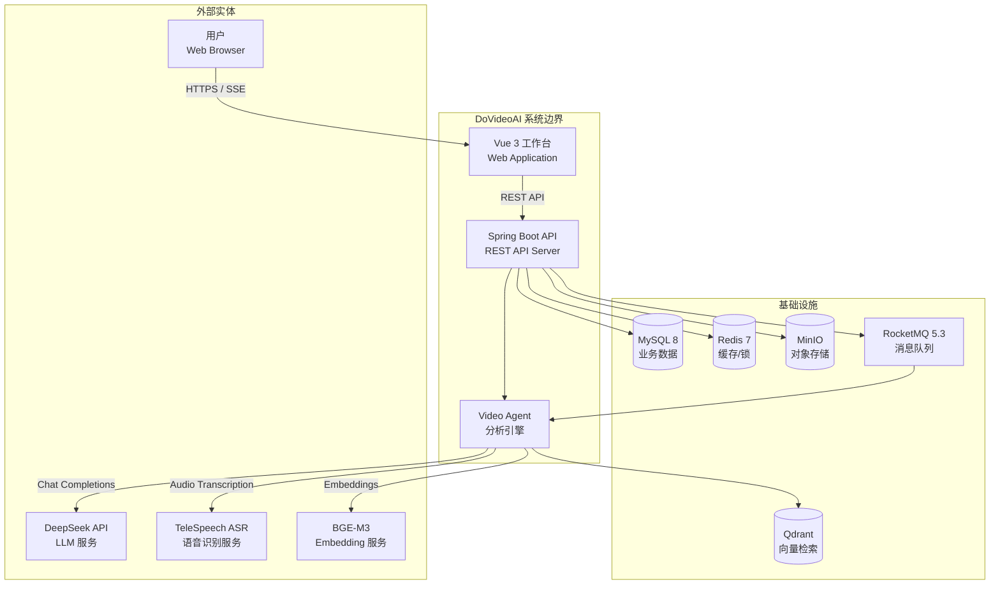

### 2.1 External Interfaces

| Consumer | Protocol | Purpose | SLA |
|----------|----------|---------|-----|
| Web App | HTTPS/REST | 用户界面 API | Best-effort |
| Web App | SSE | 任务进度推送 | Best-effort |
| DeepSeek API | HTTPS | LLM 推理 | 依赖第三方 |
| TeleSpeech ASR | HTTPS | 语音转文字 | 依赖第三方 |
| BGE-M3 | HTTPS | 文本向量化 | 依赖第三方 |

---

## 3. Container Diagram

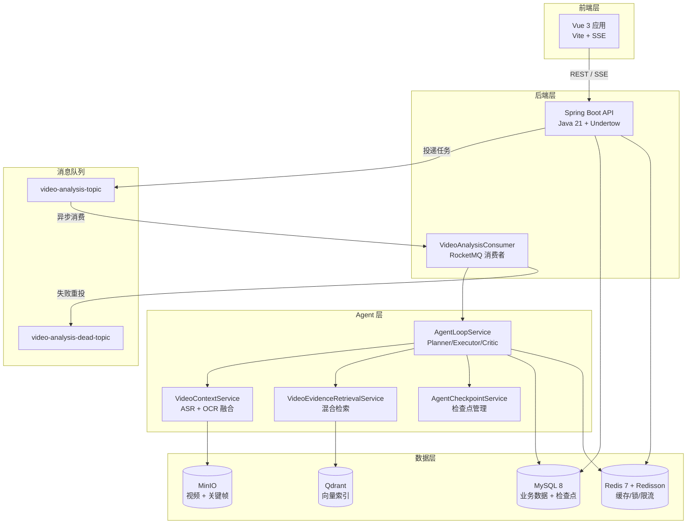

### 3.1 Container Responsibilities

| Container | Technology | Responsibility | Scaling |
|-----------|-----------|---------------|---------|
| Vue App | Vue 3 + Vite | 用户界面、文件上传、SSE 订阅 | 静态部署 |
| Spring Boot API | Java 21 + Spring Boot 3.5.9 | REST API、鉴权、媒体管理 | 水平扩展（无状态） |
| VideoAnalysisConsumer | RocketMQ Consumer | 异步消费分析任务 | 水平扩展（消费者组） |
| AgentLoopService | Java Service | Agent 编排（Planner/Executor/Critic） | 随 API 扩展 |
| VideoContextService | Java Service | ASR + OCR 并行处理 | 随 API 扩展 |
| MySQL | 8.x | 用户、媒体、检查点持久化 | 垂直扩展 + 读写分离 |
| Redis | 7.4 + Redisson | 缓存、分布式锁、限流器 | Sentinel HA |
| MinIO | Object Storage | 视频文件、关键帧存储 | 水平扩展 |
| Qdrant | Vector DB | 视频片段向量索引 | 水平扩展 |
| RocketMQ | 5.3.4 | 异步任务队列 | Broker 集群 |

---

## 4. Agent 核心逻辑链路

### 4.1 Agent 三角色架构图

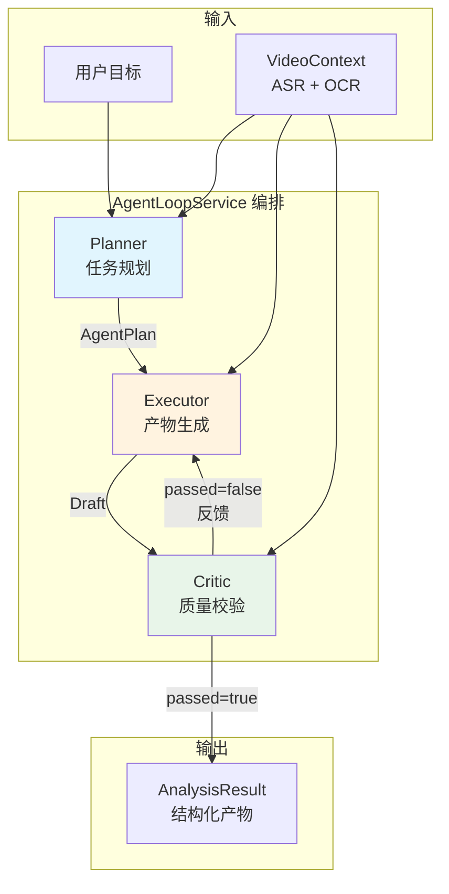

### 4.2 Agent 执行流程（详细时序图）

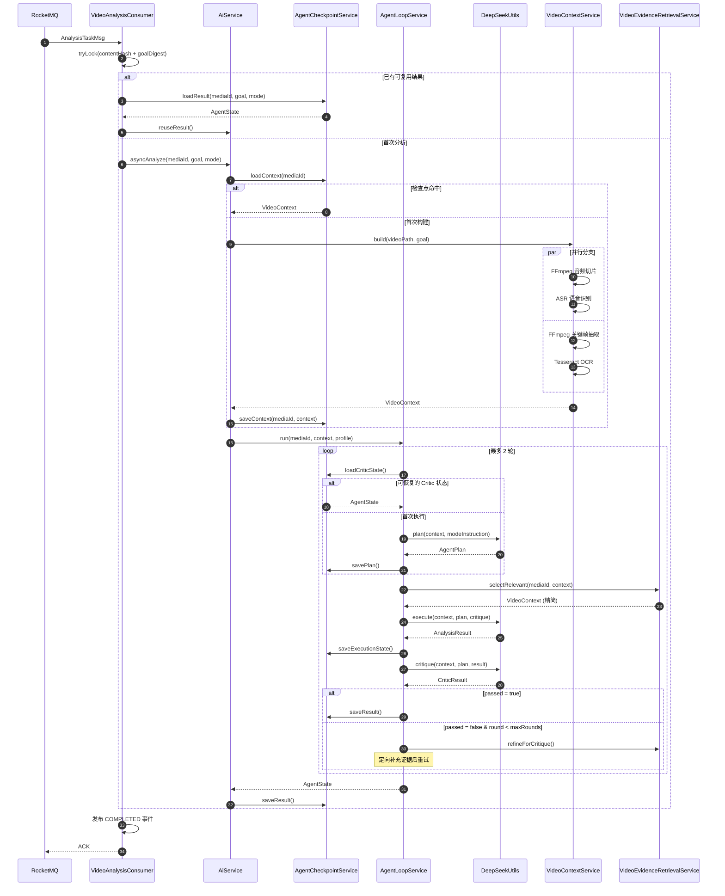

### 4.3 Agent 状态机

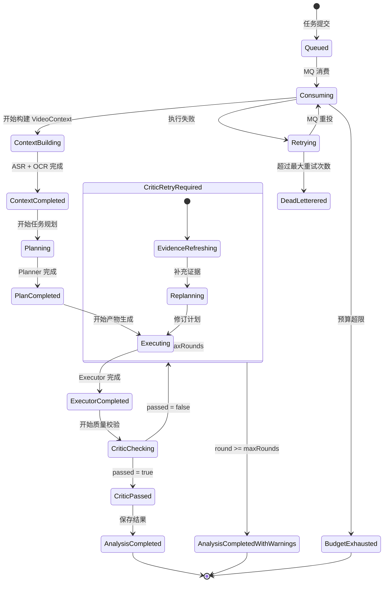

### 4.4 Agent 角色详解

#### 4.4.1 Planner（任务规划器）

**输入**：
- `VideoContext`：ASR + OCR 融合后的视频上下文
- `ModeProfile.planInstruction`：模式特定的规划指令

**输出**：
```json
{
  "understoodGoal": "对用户目标的明确理解",
  "tasks": ["任务1", "任务2", "任务3"]
}
```

**约束**：
- 任务数量：1-5 个
- 每个任务必须能仅依靠 VideoContext 中的证据完成
- 任务按执行顺序排列

**Prompt 模板**：
```
你是 Video Agent 的 Planner。理解用户目标，并拆成 1 到 5 个可执行任务。
任务必须能够仅依靠 VideoContext 中的 ASR、OCR 和时间戳证据完成。
任务按执行顺序排列，每项只描述一个可验证的分析动作。
```

#### 4.4.2 Executor（执行器）

**输入**：
- `VideoContext`：视频上下文
- `AgentPlan`：Planner 的任务计划
- `CriticResult`：上一轮的 Critic 反馈（如果有）
- `ModeProfile.executeInstruction`：模式特定的产物要求

**输出**：
```json
{
  "title": "产物标题",
  "conclusions": ["结论1", "结论2"],
  "evidence": [
    {
      "timestampMs": 120000,
      "source": "ASR",
      "content": "原始证据内容",
      "claim": "对应的结论"
    }
  ],
  "suggestions": ["建议1", "建议2"],
  "sections": [
    {"key": "outline", "title": "大纲", "items": ["..."]}
  ]
}
```

**约束**：
- 每条结论必须至少绑定一条真实证据
- `evidence.claim` 必须原样复制所支持的结论
- `timestampMs` 必须落在原始片段内
- `source` 只能是 ASR、OCR 或 ASR+OCR

#### 4.4.3 Critic（校验器）

**输入**：
- `VideoContext`：视频上下文
- `AgentPlan`：任务计划
- `AnalysisResult`：Executor 的产物草稿

**输出**：
```json
{
  "passed": false,
  "feedback": ["具体修改建议"],
  "missingRequirements": ["遗漏的要求"],
  "unsupportedClaims": ["无证据支持的结论"],
  "requiredTimestamps": [120000]
}
```

**校验标准**：
1. 是否覆盖用户目标和 Planner 的全部任务
2. conclusions 中的每条结论是否都有 evidence.claim 的明确绑定
3. 每条绑定证据的时间戳、来源和原文是否能在 VideoContext 中核验
4. 是否存在上下文不支持的结论
5. title、conclusions、evidence、suggestions 是否完整

**只有通过全部检查时 `passed` 才能为 `true`**

---

## 5. VideoContext 构建流程

### 5.1 双分支并行架构图

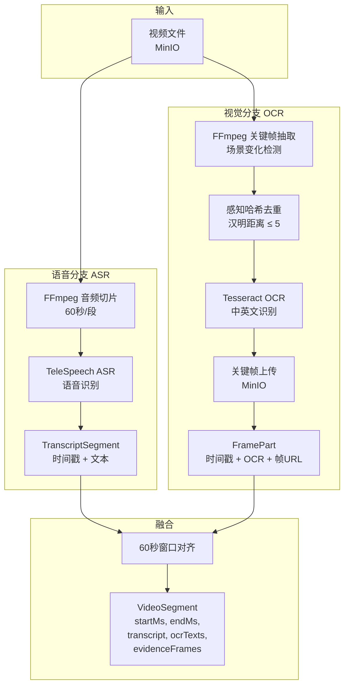

### 5.2 关键帧抽取策略

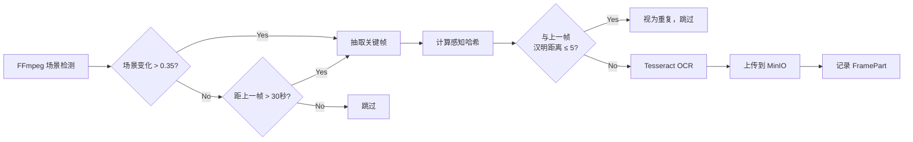

**FFmpeg 命令**：
```bash
ffmpeg -y -i video.mp4 \
  -vf "select=eq(n\,0)+gt(scene\,0.35)+gte(t-prev_selected_t\,30),showinfo" \
  -vsync vfr \
  frame_%06d.jpg
```

**参数说明**：
- `eq(n,0)`：始终抽取第一帧
- `gt(scene,0.35)`：场景变化阈值 0.35
- `gte(t-prev_selected_t,30)`：保底 30 秒采样一次（避免遗漏静态板书）

### 5.3 VideoSegment 数据结构

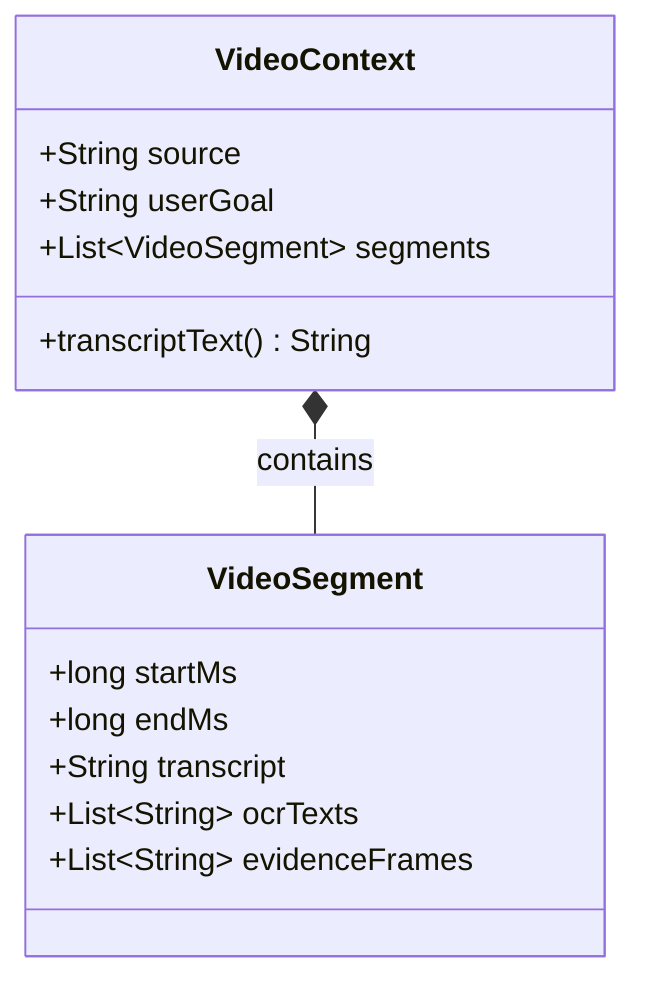

**示例**：
```text
[02:00 - 03:00]
ASR      接下来讲解二叉树的前序遍历
OCR      前序遍历：根节点、左子树、右子树
Evidence frame_000125.jpg
```

---

## 6. 长视频检索机制

### 6.1 混合检索架构

```mermaid
graph TB
    subgraph Input["输入"]
        Goal["用户目标"]
        Chunks["VideoChunk 列表<br/>5分钟/块"]
    end

    subgraph Intent["检索规划"]
        Planner["DeepSeek<br/>planRetrieval"]
        Intent["VideoRetrievalIntent<br/>semanticQuery<br/>keywords<br/>visualKeywords"]
    end

    subgraph Scoring["多路评分"]
        Semantic["语义相似度<br/>cosine(query, chunk.embedding)<br/>权重 60%"]
        Term["关键词匹配<br/>terms ∩ chunk.text<br/>权重 25%"]
        Visual["OCR 匹配<br/>visualKeywords ∩ ocrText<br/>权重 15%"]
    end

    subgraph VectorStore["向量存储"]
        Qdrant["Qdrant<br/>远程向量检索"]
        Local["本地向量<br/>chunk.embedding"]
    end

    subgraph Output["输出"]
        TopK["TopK 片段<br/>TOP_K = 3"]
        Segments["VideoSegment 列表"]
    end

    Goal --> Planner
    Planner --> Intent
    Intent --> Semantic
    Intent --> Term
    Intent --> Visual

    Chunks --> Qdrant
    Qdrant --> Semantic
    Chunks --> Local
    Local --> Semantic

    Chunks --> Term
    Chunks --> Visual

    Semantic --> TopK
    Term --> TopK
    Visual --> TopK
    TopK --> Segments
```

### 6.2 评分公式

**Chunk 级评分**：
```
score = semanticScore × 0.6
      + termScore(keywords, searchText) × 0.25
      + termScore(visualKeywords, ocrText) × 0.15
```

**Segment 级评分**：
```
score = chunkScore × 0.55
      + transcriptScore × 0.25
      + visualScore × 0.20
```

**关键词匹配评分**：
```
termScore = matchedTerms / totalTerms
```

### 6.3 VideoChunk 数据结构

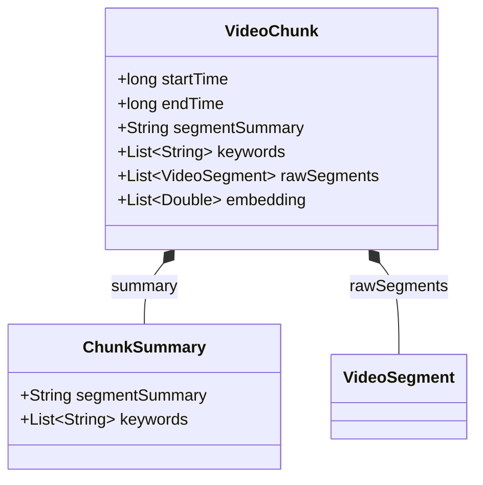

### 6.4 优雅降级策略

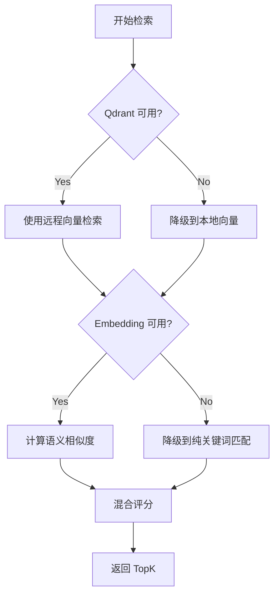

---

## 7. 检查点与断点恢复

### 7.1 检查点存储架构

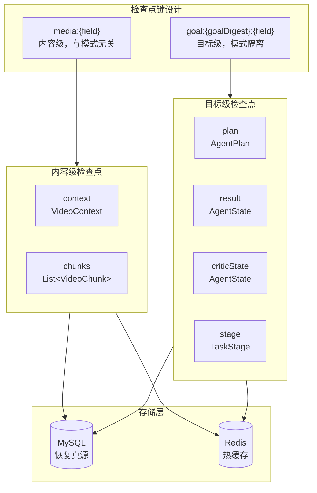

### 7.2 检查点键设计

**内容级键（与模式无关）**：
- `agent:checkpoint:{mediaId}` → `context`, `chunks`

**目标级键（模式隔离）**：
- `agent:checkpoint:{mediaId}:goal:{goalDigest}` → `plan`, `result`, `criticState`, `stage`

**goalDigest 计算**：
```java
String goalDigest = AnalysisTaskKeys.goalDigest(goal, mode);
// = SHA256(goal + ":" + mode.name())[0:16]
```

**设计理由**：
- 不同模式的同一目标互不串键
- 同一视频的不同分析目标共享 VideoContext（内容级复用）
- 检查点键与 MQ 幂等键保持一致

### 7.3 断点恢复流程

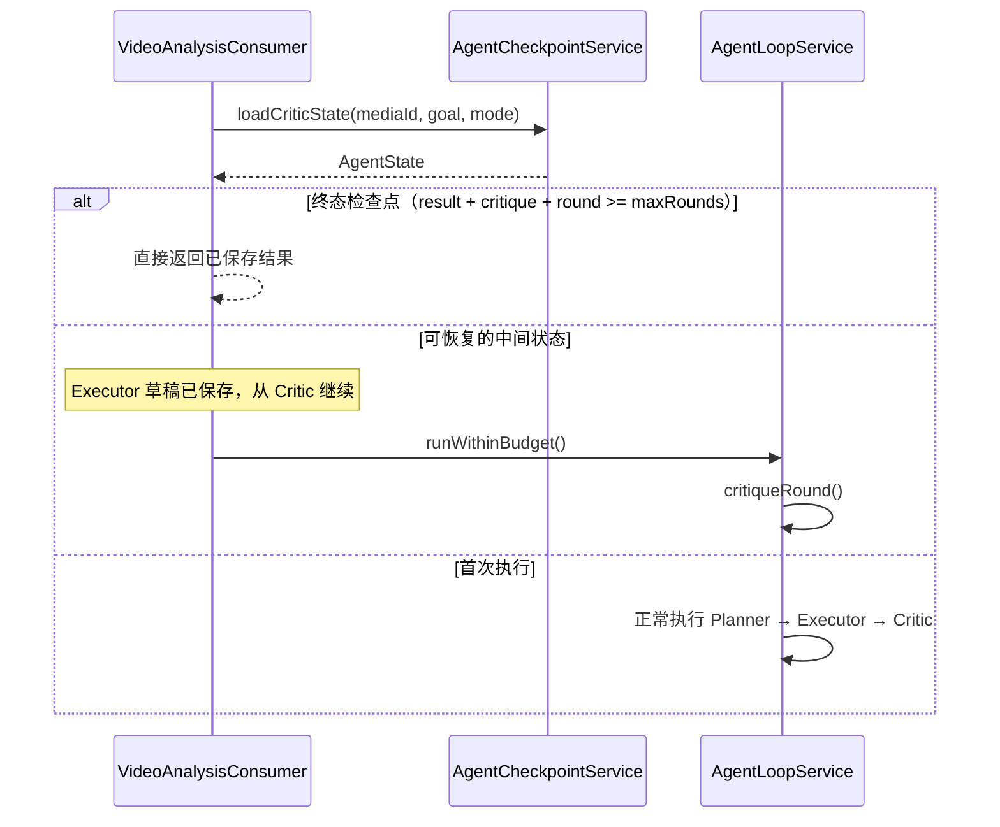

### 7.4 内容级复用

**场景**：同一视频被多个用户/目标重复提交分析

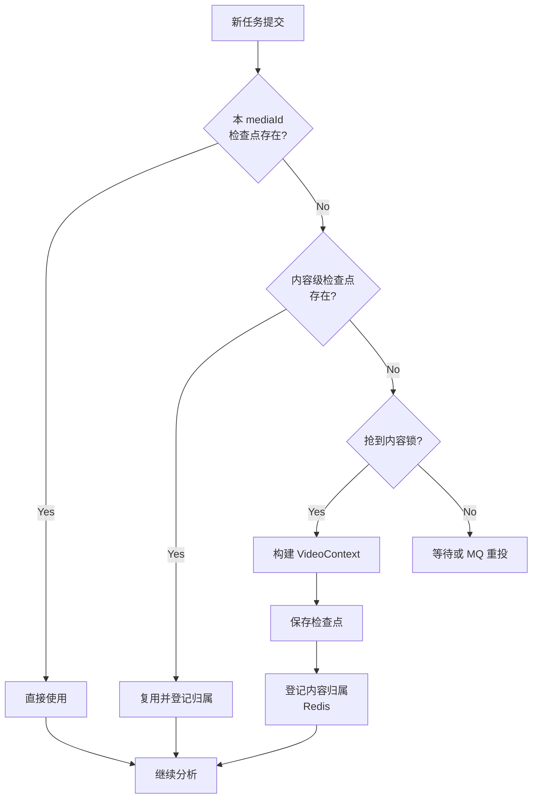

---

## 8. 分析模式系统

### 8.1 模式架构

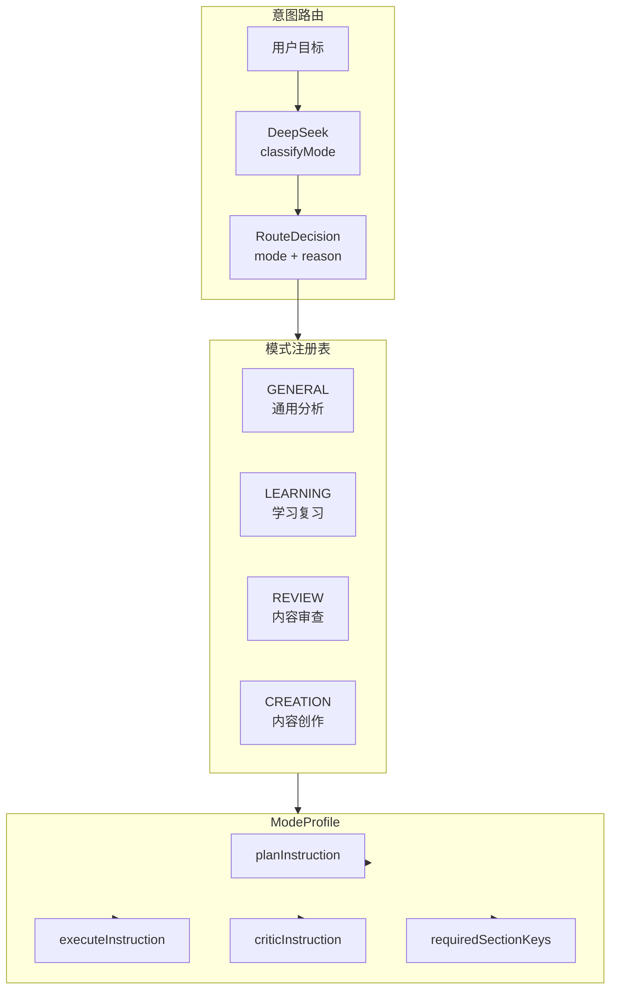

### 8.2 四种分析模式

| Mode | displayName | planInstruction | requiredSectionKeys |
|------|-------------|-----------------|---------------------|
| GENERAL | 通用分析 | "" | [] |
| LEARNING | 学习复习 | "按知识主题而非时间顺序拆解任务" | outline, keypoints, quiz, pitfalls |
| REVIEW | 内容审查 | "把目标拆成对每个主要论点的可验证审查项" | fallacies, exaggerations, omissions, doubtful |
| CREATION | 内容创作 | "围绕'可发布资产'拆解" | highlights, titles, intro, script |

### 8.3 模式扩展点

新增分析模式只需：
1. 在 `AnalysisMode` 枚举添加新值
2. 在 `ModeRegistry` 构造器注册 `ModeProfile`
3. 核心编排（Planner/Executor/Critic）完全复用

---

## 9. 数据架构

### 9.1 核心实体关系

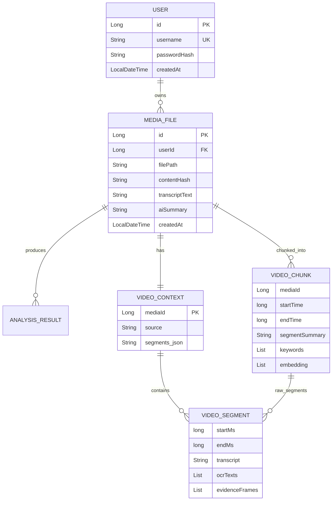

### 9.2 检查点数据流

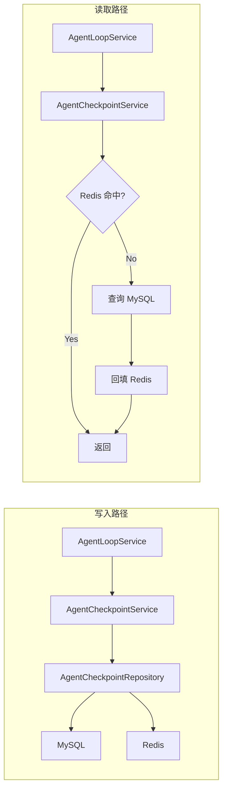

---

## 10. 成本与预算控制

### 10.1 Agent 预算机制

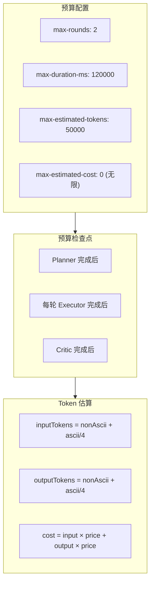

### 10.2 限流策略

| 层级 | 限流器 | 配额 | 说明 |
|------|--------|------|------|
| 用户级 | `limit:ai:user:{userId}` | 5 次/分钟 | 防止单用户过度消耗 |
| 全局级 | `limit:ai:global` | 30 次/分钟 | 保护第三方 API 配额 |
| 路由级 | `limit:ai:route:user:{userId}` | 10 次/分钟 | 意图路由独立配额 |

---

## 11. 错误处理与容错

### 11.1 消费者错误处理策略

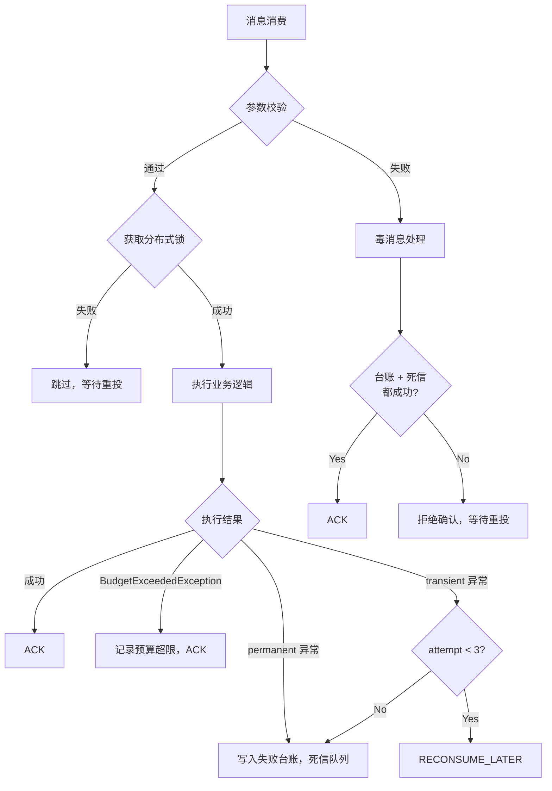

### 11.2 永久失败判定

```java
// 沿 cause 链向下查找确定性失败
boolean isPermanentFailure(Throwable error) {
    for (int depth = 0; current != null && depth < 16; depth++) {
        if (current instanceof IllegalArgumentException
            || current instanceof SecurityException
            || current instanceof NoSuchElementException) {
            return true;  // 重投也不会成功
        }
    }
    return false;
}
```

### 11.3 分支容错

VideoContext 构建时 ASR/OCR 双分支独立执行：
- 单分支失败时保留另一分支结果
- 双分支都失败才抛出异常

---

## 12. 可观测性

### 12.1 Agent Telemetry

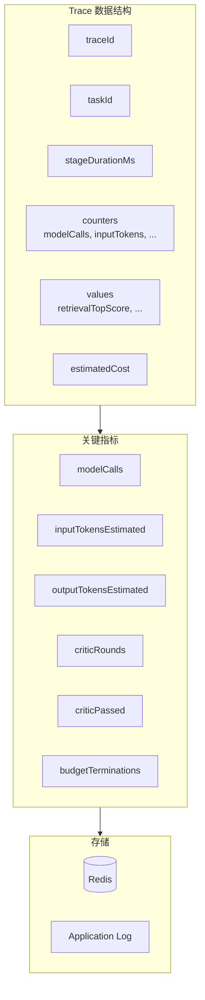

### 12.2 SSE 任务事件

```mermaid
sequenceDiagram
    participant Frontend as Vue App
    participant API as Spring Boot
    participant Redis as Redis Pub/Sub

    Frontend->>API: GET /analysis/{mediaId}/events
    API->>Redis: Subscribe(task:{mediaId})
    API-->>Frontend: SSE Connection

    loop 任务执行中
        Redis->>API: TaskEvent
        API-->>Frontend: data: {"state": "PROCESSING", "stage": "AGENT_LOOP"}
    end

    Redis->>API: TaskEvent (COMPLETED)
    API-->>Frontend: data: {"state": "COMPLETED", ...}
    API-->>Frontend: Close Connection
```

---

## 13. 已知问题与优化建议

### 13.1 当前问题识别

| 问题类别 | 问题描述 | 影响 | 优先级 |
|----------|----------|------|--------|
| **安全** | Prompt 直接拼接 VideoContext JSON | 潜在注入风险 | High |
| **成本** | Token 估算使用字符数近似 | 成本预算不精确 | Medium |
| **性能** | Critic 固定 2 轮，无动态调整 | 简单任务浪费，复杂任务不足 | Medium |
| **准确性** | 证据校验依赖文本包含关系 | 同义词、表述差异导致误判 | Medium |
| **可用性** | Embedding 服务无重试 | 第三方故障直接影响检索 | High |
| **前端** | SSE 重连指数退避最长 15s | 弱网环境体验不佳 | Low |

### 13.2 优化方案

#### 13.2.1 Prompt 注入防护增强

**现状**：
```java
String prompt = "VideoContext: " + objectMapper.writeValueAsString(context);
```

**优化方案**：
1. 使用结构化 Prompt 模板，明确数据边界
2. 添加输入清洗层，过滤可疑字符序列
3. 使用 LangChain4j 的 Structured Prompt 功能

```java
// 优化后
var promptTemplate = StructuredPrompt.of("""
    你是 Video Agent 的 Planner。
    <video-context>
    {{context}}
    </video-context>
    请理解用户目标...
    """);
```

#### 13.2.2 精确 Token 计算

**现状**：
```java
long estimateTokens(String text) {
    long nonAscii = text.codePoints().filter(cp -> cp > 127).count();
    long ascii = text.codePoints().count() - nonAscii;
    return nonAscii + (ascii + 3) / 4;
}
```

**优化方案**：
1. 使用 tiktoken-java 或 similar 库进行精确计算
2. 缓存 tokenizer 实例避免重复初始化
3. 在请求前预估，而非请求后统计

```java
// 优化后
private final Encoding encoding = EncodingRegistry.getEncoding("cl100k_base");

long countTokens(String text) {
    return encoding.countTokens(text);
}
```

#### 13.2.3 动态 Critic 轮次

**现状**：固定 2 轮

**优化方案**：
1. 根据 Critic 反馈严重程度决定是否重试
2. 添加"信心分数"，高分直接通过
3. 简单任务（视频 < 5分钟）减少轮次

```java
int determineRounds(CriticResult critique, VideoContext context) {
    if (critique.passed()) return 0;

    int severityScore = critique.feedback().size()
        + critique.unsupportedClaims().size() * 2;

    if (severityScore <= 1 && context.segments().size() < 5) {
        return 0; // 小问题，直接通过
    }
    if (severityScore <= 3) {
        return 1; // 中等问题，1轮修正
    }
    return 2; // 严重问题，2轮修正
}
```

#### 13.2.4 证据校验增强

**现状**：
```java
boolean textMatches(String evidence, String candidate) {
    return normalizedCandidate.contains(normalizedEvidence);
}
```

**优化方案**：
1. 引入语义相似度校验（Embedding cosine > 0.8）
2. 添加模糊匹配（编辑距离）
3. 支持同义词词典

```java
boolean supportsClaim(String claim, Evidence evidence, VideoContext context) {
    // 1. 文本包含（快速路径）
    if (textContains(claim, context)) return true;

    // 2. 语义相似度（精确路径）
    double similarity = cosineSimilarity(
        embed(claim),
        embed(contextSegment(context, evidence.timestampMs()))
    );
    return similarity > 0.85;
}
```

#### 13.2.5 Embedding 重试机制

**现状**：无重试

**优化方案**：
```java
public List<Double> embed(String text) {
    return retryWithBackoff(
        () -> doEmbed(text),
        3, // max attempts
        Duration.ofMillis(500) // initial backoff
    );
}

private List<Double> doEmbed(String text) {
    // 现有实现
}
```

#### 13.2.6 SSE 连接优化

**现状**：
```javascript
const delay = Math.min(15_000, 1_000 * 2 ** reconnectAttempt++)
```

**优化方案**：
1. 降低最大退避时间到 5s
2. 添加心跳检测
3. 后台标签页降低重连频率

```javascript
const maxDelay = document.hidden ? 30_000 : 5_000;
const delay = Math.min(maxDelay, 1_000 * 2 ** reconnectAttempt);
```

---

## 14. 部署架构

### 14.1 本地开发环境

```mermaid
graph TB
    subgraph DockerCompose["Docker Compose"]
        MySQL["MySQL 8<br/>port: 3306"]
        Redis["Redis 7<br/>port: 6379"]
        MinIO["MinIO<br/>port: 9000/9001"]
        Qdrant["Qdrant<br/>port: 6333"]
        RocketMQ["RocketMQ<br/>namesrv: 9876"]
    end

    subgraph Local["本地服务"]
        Backend["Spring Boot<br/>port: 9090"]
        Frontend["Vite Dev<br/>port: 5173"]
    end

    Frontend -->|Vite Proxy| Backend
    Backend --> MySQL
    Backend --> Redis
    Backend --> MinIO
    Backend --> Qdrant
    Backend --> RocketMQ
```

### 14.2 环境配置

| 环境 | 用途 | 基础设施 | 自动部署 |
|------|------|----------|----------|
| local | 开发调试 | Docker Compose | — |
| dev | 集成测试 | 云服务器 | On merge |
| production | 生产环境 | K8s / 云服务器 | 手动审批 |

### 14.3 启动依赖

| 组件 | 版本要求 | 说明 |
|------|----------|------|
| JDK | 21 | 后端运行环境 |
| Node.js | 22 | 前端构建 |
| Docker | Compose v2 | 中间件编排 |
| FFmpeg | 任意 | 音视频处理 |
| Tesseract | 含 chi_sim + eng | OCR |

---

## 15. 技术栈汇总

| 层次 | 技术 | 版本 | 用途 |
|------|------|------|------|
| **Web** | Vue 3 | 3.x | 用户界面 |
| **Web** | Vite | 6.x | 构建工具 |
| **Web** | Marked | 15.x | Markdown 渲染 |
| **API** | Java | 21 | 后端语言 |
| **API** | Spring Boot | 3.5.9 | Web 框架 |
| **API** | MyBatis-Plus | 3.5.x | ORM |
| **Async** | RocketMQ | 5.3.4 | 消息队列 |
| **Cache** | Redis | 7.4 | 缓存 |
| **Cache** | Redisson | 3.x | 分布式锁 |
| **DB** | MySQL | 8.x | 持久化 |
| **Storage** | MinIO | 最新 | 对象存储 |
| **Vector** | Qdrant | 最新 | 向量检索 |
| **Video** | FFmpeg | 最新 | 音视频处理 |
| **OCR** | Tesseract | 最新 | 文字识别 |
| **LLM** | LangChain4j | 1.x | AI 框架 |
| **LLM** | DeepSeek V3.2 | — | 主模型 |
| **Embedding** | BGE-M3 | — | 向量化 |

---

## 16. 附录

### 16.1 关键配置项

```yaml
# AI 配置
ai:
  deepseek:
    api-key: ${SILICONFLOW_API_KEY}
    base-url: https://api.siliconflow.cn/v1
    model: deepseek-ai/DeepSeek-V3.2
    timeout-seconds: 300
    input-price-per-million: 0
    output-price-per-million: 0
  embedding:
    model: BAAI/bge-m3

# Agent 预算
agent:
  budget:
    max-rounds: 2
    max-duration-ms: 120000
    max-estimated-tokens: 50000
    max-estimated-cost: 0

# RocketMQ
rocketmq:
  topic:
    video-analysis: video-analysis-topic
    video-analysis-dead: video-analysis-dead-topic
  consumer:
    group: video-analysis-group

# 向量库
vector:
  qdrant:
    enabled: true
    url: http://localhost:6333
    collection: video_chunks
```

### 16.2 关键类图

```mermaid
classDiagram
    class AgentLoopService {
        +run(Long mediaId, VideoContext context, ModeProfile profile) AgentState
        -runWithinBudget(Long mediaId, VideoContext context, ModeProfile profile) AgentState
        -resolvePlan(Long mediaId, VideoContext context, AgentState savedState, ModeProfile profile) AgentPlan
        -executeRound(...) AgentState
        -critiqueRound(...) AgentState
        -enforceEvidenceBounds(...) CriticResult
        -enforceStructureBounds(...) CriticResult
    }

    class AiService {
        +asyncAnalyze(Long mediaId, String goal, AnalysisMode mode)
        +followUp(Long mediaId, String originalGoal, String question) String
        +searchEvidence(Long mediaId, String query) List~VideoEvidenceHit~
        -resolveContext(MediaFile, String, String, AnalysisMode) VideoContext
        -buildContext(MediaFile, String, String, String, AnalysisMode) VideoContext
    }

    class VideoContextService {
        +build(String videoPath, String userGoal, String traceId) VideoContext
        -extractKeyFrames(...) List~FramePart~
        -merge(List~TranscriptSegment~, List~FramePart~) List~VideoSegment~
    }

    class AgentCheckpointService {
        +loadContext(Long mediaId) VideoContext
        +loadResult(Long mediaId, String goal, AnalysisMode mode) AgentState
        +saveContext(Long mediaId, VideoContext context)
        +saveResult(Long mediaId, AgentState state, AnalysisMode mode)
    }

    AiService --> AgentLoopService
    AiService --> VideoContextService
    AiService --> AgentCheckpointService
    AgentLoopService --> AgentCheckpointService
```

### 16.3 术语表

| 术语 | 说明 |
|------|------|
| VideoContext | ASR + OCR 融合后的视频上下文 |
| VideoSegment | 60秒时间窗口内的语音+文字信息 |
| VideoChunk | 5分钟片段，包含摘要和 Embedding |
| AgentPlan | Planner 生成的任务计划 |
| CriticResult | Critic 的校验结果 |
| Checkpoint | 检查点，用于断点恢复 |
| ModeProfile | 分析模式的差异化配置 |
| goalDigest | 目标摘要，用于检查点键 |

---

**文档版本**: 1.0.0
**最后更新**: 2026-08-19
**维护者**: Video Agent Team
